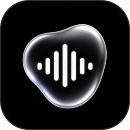
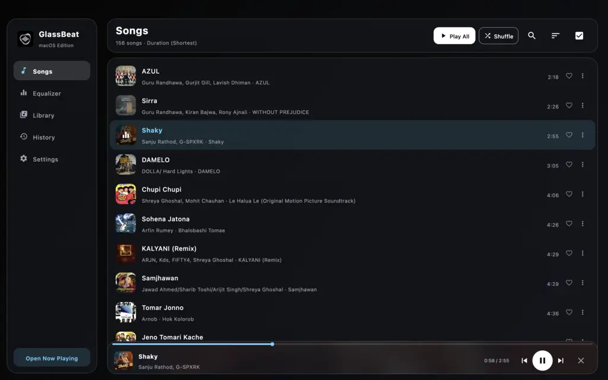
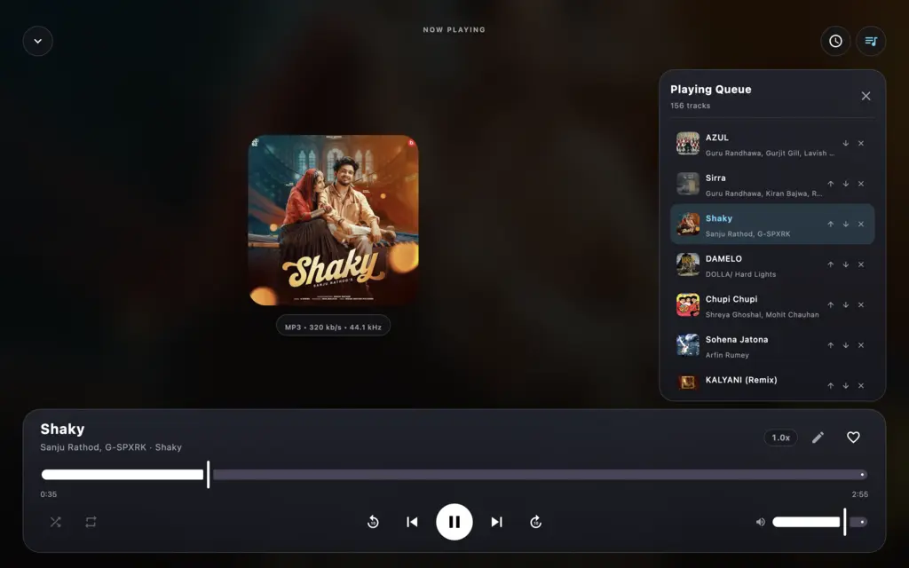
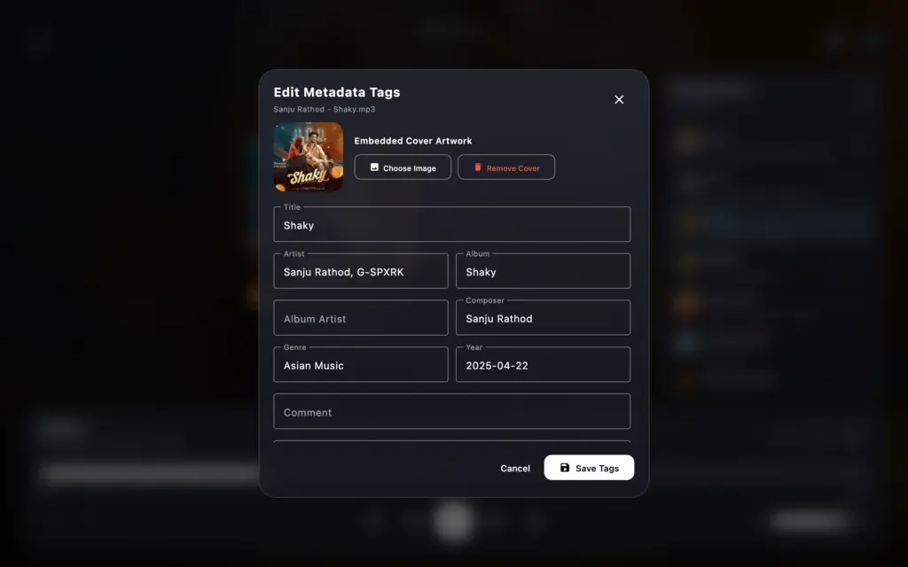
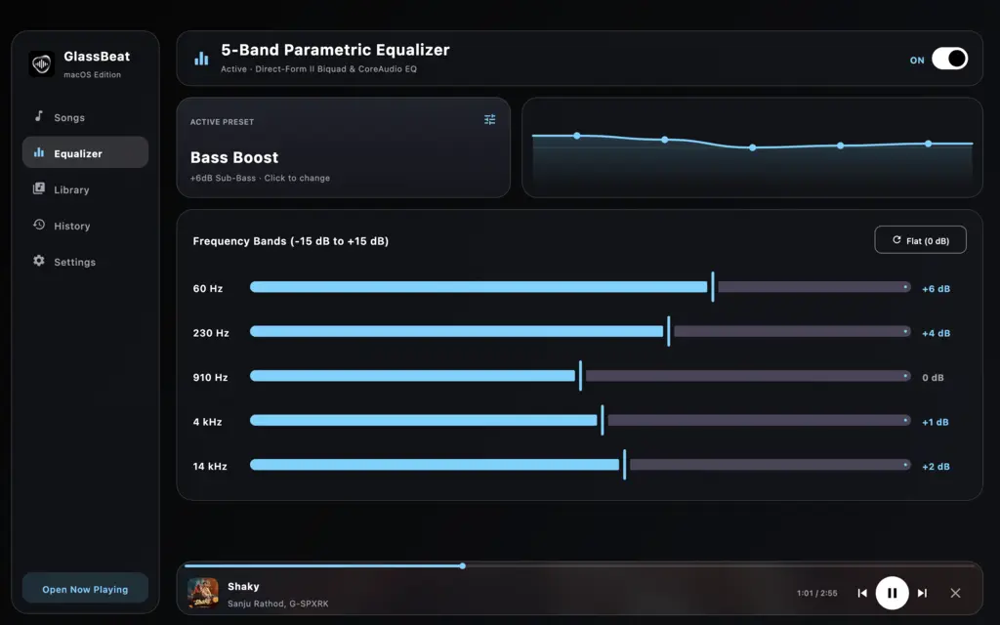
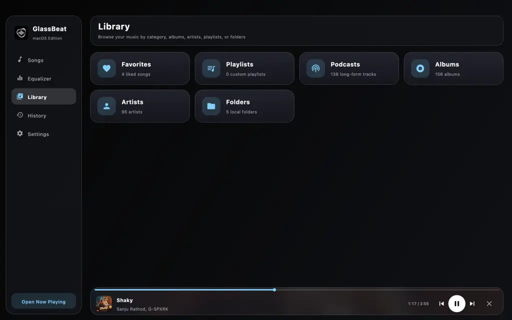
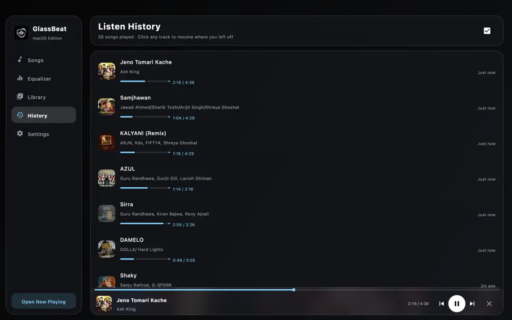
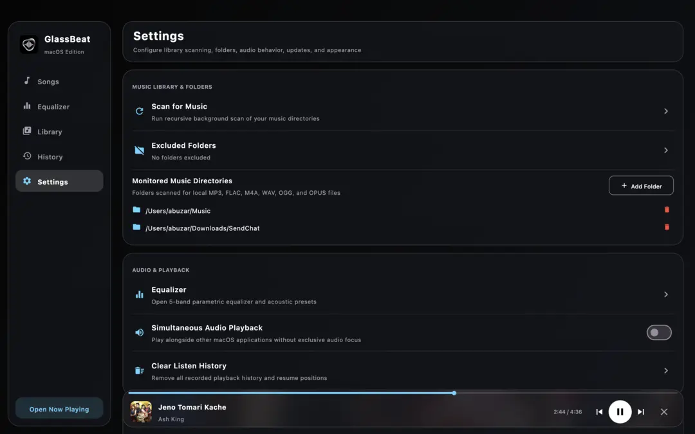
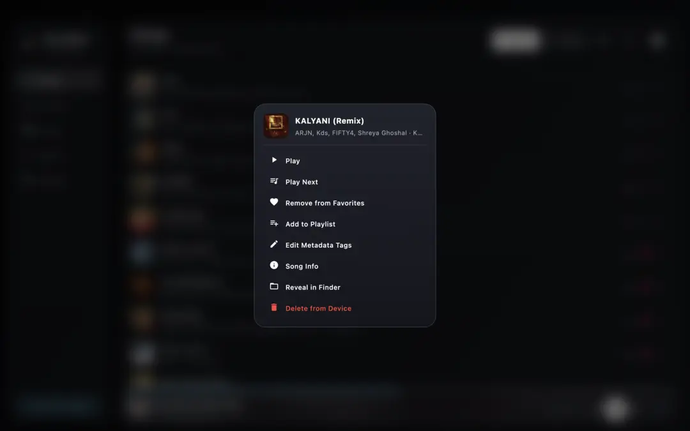

<div align="center">
  

  # GlassBeat for macOS

  **A sleek, glassmorphic local music player and 5-band parametric equalizer for macOS**

  [](https://bytegif.com/glassbeat)
  [](https://github.com/abzgif/mac-glassbeat/releases)
  [](https://play.google.com/store/apps/details?id=com.bytegif.glassbeat)
  [](https://github.com/abzgif/mac-glassbeat)

  [**Official Website**](https://bytegif.com/glassbeat) • [**Download for macOS (.dmg)**](https://github.com/abzgif/mac-glassbeat/releases) • [**Get it on Google Play (Android)**](https://play.google.com/store/apps/details?id=com.bytegif.glassbeat)
</div>

## Overview

**GlassBeat** is a modern, offline-first music player crafted with a signature **Glassmorphic UI**—combining deep obsidian and frosted light surfaces, dynamic album-art ambient blur, and studio-grade audio control.

Originally built for Android and now ported to **macOS** using **Kotlin Multiplatform (Compose for Desktop)**, GlassBeat pairs a responsive desktop interface with a native **macOS CoreAudio (`AVAudioEngine` + `AVAudioUnitEQ` + `AVAudioUnitTimePitch`)** pipeline and a pure-Kotlin **Direct-Form II Transposed (DF2T) 5-band biquad DSP cascade**. Whether you listen to lossless `FLAC` and `WAV` collections or everyday `MP3`, `M4A/AAC`, `OGG`, and `OPUS` tracks, GlassBeat delivers gapless-feel transport, real-time acoustic shaping, and full embedded tag editing without cloud lock-in or telemetry.

## Screenshots

| Songs & Seekable Mini Player | Expanded Now Playing & Queue Drawer |
| :---: | :---: |
|  |  |
| **Metadata Tag & Cover Art Editor** | **5-Band Parametric Equalizer** |
|  |  |
| **Library Categories** | **Listen History & Smart Resume** |
|  |  |
| **Settings & Directory Manager** | **Glassmorphic Track Context Menu** |
|  |  |

## Also Available on Android

Want the same GlassBeat experience on your phone or tablet? **GlassBeat is available for Android on the Google Play Store**:

- **Android App (Google Play Store)**: [https://play.google.com/store/apps/details?id=com.bytegif.glassbeat](https://play.google.com/store/apps/details?id=com.bytegif.glassbeat)
- **Official Product Website**: [https://bytegif.com/glassbeat](https://bytegif.com/glassbeat)
- **macOS Source & Releases**: [https://github.com/abzgif/mac-glassbeat](https://github.com/abzgif/mac-glassbeat)

## Key Features

### 1. Glassmorphic Design & Adaptive Themes
- **Obsidian Dark & Frosted Light Modes**: Switch instantaneously between GlassBeat's signature deep dark palette (`#050505`) and crisp light palette (`#F5F6F8`).
- **Real-Time Gaussian Blur Backdrops**: Dynamic blurred album artwork powers both the expanded **Now Playing** screen and the floating **Mini Player**, while every modal dialog (**Sort Songs By**, **3-Dot Track Menu**, **Metadata Tag Editor**, **Sleep Timer**, **Playback Speed**, and **Equalizer Presets**) renders over a live `22.dp` Gaussian-blurred backdrop.
- **Native macOS Window Integration**: Full-content transparent titlebar, rounded macOS squircle iconography, and keyboard shortcuts (`Cmd+F` to search, `Esc` to dismiss modals or minimize Now Playing).

### 2. CoreAudio & 5-Band Parametric Equalizer
- **Native macOS Audio Engine**: Hardware-accelerated decoding and output via macOS `AVAudioEngine`, paired with a pure-Kotlin `EqualizerAudioProcessor` (Direct-Form II Transposed 5-band biquad filter cascade with `tanh` soft-clipping protection).
- **5 Tunable Frequency Bands**: Adjust `60 Hz`, `230 Hz`, `910 Hz`, `4 kHz`, and `14 kHz` from `-15 dB` to `+15 dB` with a live spline frequency-response curve visualization.
- **10 Built-in Acoustic Presets**: Includes **Bass Boost**, **Classical**, **Dance**, **Folk**, **Heavy Metal**, **Hip Hop**, **Jazz**, **Pop**, **Rock**, and **Custom**.

### 3. Comprehensive Library & Smart Organization
- **Songs View**: Instant search across Title, Artist, and Album, 6 sorting modes (`Title A–Z`, `Title Z–A`, `Date Added Newest/Oldest`, `Duration Longest/Shortest`), and batch multi-selection (`Select All`, `Play Next`, `Add to Playlist`, `Delete`).
- **Library Categories**: Browse by **Favorites**, **Custom Playlists** (create, rename, delete, add/remove tracks), **Podcasts** (long-form audio), **Albums** (responsive cover grid), **Artists**, and **Local Folders**.
- **Listen History with Smart Resume**: Automatically records recently played tracks with a visual progress bar and resumes playback from the exact timestamp where you left off.
- **Folder & Exclusion Control**: Monitor `~/Music` and any additional macOS directories while excluding specific subfolders via the **Excluded Folders** manager.

### 4. Expanded Now Playing & Seekable Mini Player
- **Interactive Seekable Mini Player**: Click or drag directly along the top seekbar of the floating Mini Player to scrub through tracks without leaving your current view.
- **Audio Tech Specs Badge**: Displays real-time file format, bitrate (`kb/s`), and sample rate (`kHz`) directly below the album artwork.
- **Pitch-Preserved Playback Speed (`0.5x` – `2.0x`)**: Smooth slider and one-click preset chips (`0.5x`, `0.75x`, `1.0x`, `1.25x`, `1.5x`, `1.75x`, `2.0x`) powered by `AVAudioUnitTimePitch`.
- **Sleep Timer**: Set a countdown for `15`, `30`, `45`, `60`, or `90` minutes, or pause automatically at the **End of current song**.
- **Interactive Queue Drawer**: Reorder upcoming tracks up/down, jump to any track, or remove items on the fly.

### 5. Built-in Audio Metadata & Cover Art Editor
- **Full Tag Editing**: Edit **Title**, **Artist**, **Album**, **Album Artist**, **Composer**, **Genre**, **Year**, **Comment**, and **Lyrics** directly on disk.
- **Embedded Cover Artwork**: Replace or remove embedded album art (`JPG`, `PNG`, `WEBP`) with immediate cache refresh.
- **Broad Container Support**: Powered by **JAudioTagger** for `MP3` (`ID3v1`/`ID3v2.3`/`ID3v2.4`), `FLAC`, `M4A`/`MP4`, `OGG Vorbis`, and `WAV`, plus a custom pure-Kotlin RFC 7845 / RFC 3533 **Ogg Opus** reader/writer (`OpusTagHandler`) that preserves Ogg page sequences and CRC-32 checksums.

### 6. Built-in OTA Updater with Auto-Reopen
- **One-Click Updates**: Check for new releases directly from **Settings → Check for Updates**.
- **Automatic Install & Relaunch**: Downloads the latest `.dmg` or `.zip` release from GitHub Releases with a live progress bar, mounts and installs the updated `GlassBeat.app` bundle, and automatically reopens the updated application.

## Installation & Running from Source

### Download Pre-Built macOS Installer
1. Visit the [**GitHub Releases**](https://github.com/abzgif/mac-glassbeat/releases) page or [**bytegif.com/glassbeat**](https://bytegif.com/glassbeat).
2. Download the latest `GlassBeat-1.1.5.dmg` installer, open it, and drag **GlassBeat** into your `/Applications` folder.

### Build & Run from Source
1. Clone the repository:
   ```bash
   git clone https://github.com/abzgif/mac-glassbeat.git
   cd mac-glassbeat
   ```
2. Launch the development build using the included helper script (which automatically detects JDK 17+ from Android Studio, IntelliJ IDEA, or Homebrew and compiles the Swift CoreAudio helper):
   ```bash
   chmod +x run_macos.sh
   ./run_macos.sh
   ```
3. Package a standalone macOS `.dmg` installer locally:
   ```bash
   ./run_macos.sh :composeApp:packageDmg
   ```
   The generated `.dmg` will be placed in `composeApp/build/compose/binaries/main/dmg/`.

## Tech Stack

- **UI Framework**: [Compose Multiplatform for Desktop](https://www.jetbrains.com/lp/compose-multiplatform/) (Material 3 + Skia Graphics & Blur Shaders)
- **Language**: Kotlin 2.1 (JVM 17) & Swift (`AVFoundation` / `AudioToolbox` CoreAudio helper)
- **Local Persistence**: SQLite (`sqlite-jdbc`) + `kotlinx.serialization` JSON preferences in `~/Library/Application Support/GlassBeat/`
- **Metadata Engine**: `JAudioTagger` 3.0.1 + custom RFC 7845 `OpusTagHandler`
- **CI/CD**: GitHub Actions (`macos-latest` workflow in `.github/workflows/build-macos.yml`)

## Links

- **Official Website**: [https://bytegif.com/glassbeat](https://bytegif.com/glassbeat)
- **Android App (Google Play Store)**: [https://play.google.com/store/apps/details?id=com.bytegif.glassbeat](https://play.google.com/store/apps/details?id=com.bytegif.glassbeat)
- **macOS GitHub Repository**: [https://github.com/abzgif/mac-glassbeat](https://github.com/abzgif/mac-glassbeat)
